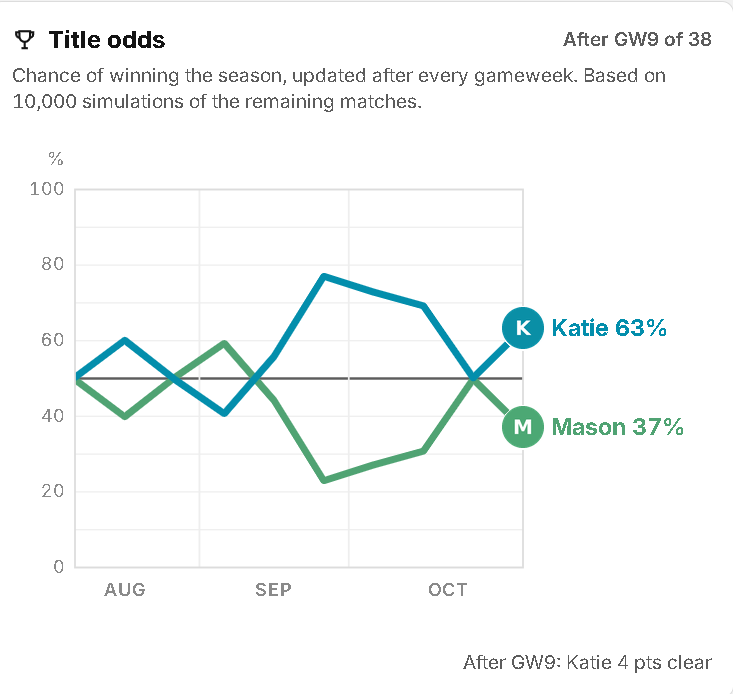
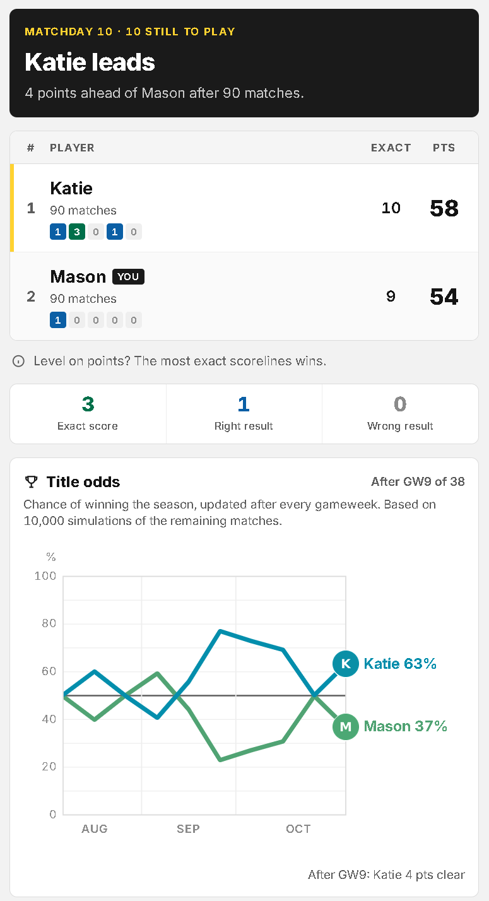
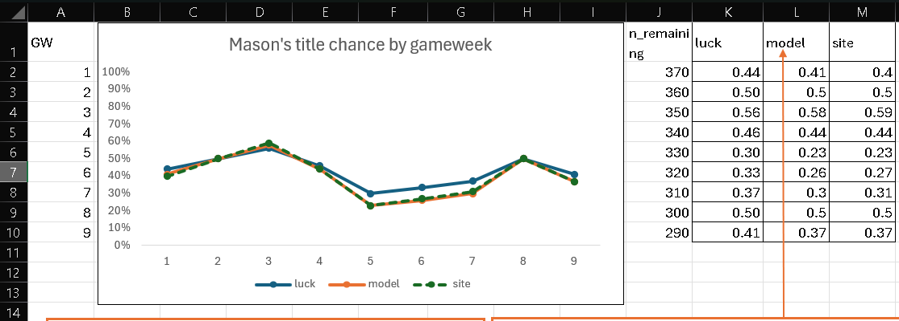

# EPL Tally: title odds model

What chance does each player have of winning the season, from where things stand right now?

This repo explains the title-odds model behind [EPL Tally](https://github.com/Esoteric-star/epl-tally-public), my self-hosted Premier League prediction game. It also documents my rebuild of that model from scratch in Excel 365, checked against the live site at every gameweek.

The title odds chart as it runs on the site. After nine gameweeks, my Excel rebuild matches it to within 1 percentage point every week.

## The question

EPL Tally is a two-player game between me (Mason) and Katie. We each predict every Premier League score. An exact score is worth 3 points, the right result 1, anything else 0. If we finish level on points, exact scores decide it. If that's level too, it goes to Katie (the app breaks ties alphabetically).

After gameweek 9, 90 matches in, Katie led 58 to 54. That left 290 matches to play. So what's my chance of winning the title?

## Three answers to the same question

| Method | Mason's chance | What it assumes |
|---|---|---|
| Luck formula | 41% | We're equally good from here on. Katie's lead is pure noise. |
| Simple simulation | 17% | The first 90 matches show exactly how good each of us is. |
| Dirichlet-multinomial model | 37% | Somewhere in between, weighted by how much 90 matches really tells you. |

The first two are both wrong, in opposite directions. A 4-point lead over 90 matches is weak evidence that Katie is the better predictor, but it isn't no evidence. The simple simulation treats it as proof and takes my chances down to 17%. The model's whole job is to say how much the lead should count.

## How the model works

- Every match gives a joint outcome: my points and Katie's points. That's one of nine combinations, from (0, 0) to (3, 3).
- For each simulated season, the model draws a set of probabilities for those nine outcomes from a Dirichlet distribution. Then it plays out the remaining matches with those probabilities, applies the tiebreak and records who won. The site runs 10,000 seasons.
- The Dirichlet parameters are a prior plus the counts actually observed. The prior says "assume equal skill". It's the observed grid plus a small base, made symmetrical (each cell averaged with its mirror), then scaled to a strength of 200. In other words, it's worth 200 matches of equal-skill evidence.
- Drawing fresh probabilities for every simulated season is the important part. It carries two kinds of uncertainty: match-to-match noise, and not knowing who is actually better. The simple simulation only has the first.

Prior strength sets how quickly the model believes the leader is genuinely better. At GW9, a strength of 0 gives about 32%, 200 gives 37%, and 10,000 gives about 41%. At 10,000 the prior swamps the data and the model collapses back to the luck formula.

## What I built

**On the site.** The title-odds feature in EPL Tally, written in Python with NumPy, and shown as a chart on the leaderboard. An hourly cron job fetches new results, then refreshes the odds. Added in November 2026. The model code is in [`site/title_odds.py`](site/title_odds.py).

**In Excel 365.** A full rebuild with no code and no add-ins, built and checked one stage at a time:

1. **Import.** Power Query loads the three CSV exports. It filters to finished 2026-27 Premier League matches (90 rows) and inner joins predictions to results. 180 of 202 predictions matched. The other 22 were picks for matches that hadn't been played yet.
2. **Scoring.** Helper columns for result and exact score. Totals match the site: Mason 54 points with 9 exact, Katie 58 with 10.
3. **Running table.** Cumulative points and exact scores by gameweek, plus the gap between us.
4. **Joint outcome grid.** A 3x3 count of (Mason, Katie) outcomes built with dynamic arrays. Correlation between our scores is 0.37.
5. **Luck formula.** A closed-form normal approximation. It reproduces the site's luck figure exactly at every gameweek.
6. **Simple simulation.** Monte Carlo with 1,000 seasons, giving about 17%. I then showed this is just the luck formula plus drift from the observed edge (closed form: 17.07%).
7. **Full model.** Dirichlet draws built from `GAMMA.INV`, with cumulative probabilities from `SCAN` and a tunable prior strength. It gives about 37% at GW9, matching the site.
8. **Gameweek selector.** One input cell re-runs the whole model as of any gameweek, which made a week-by-week comparison with the site possible.
9. **Scenarios.** A closed-form approximation of the model (within about 2 percentage points of the simulation), used for a "what if" table on GW10 and a target calculator.

The full walkthrough, with the maths and a screenshot for each stage, is in [docs/method.md](docs/method.md).

## How I checked it

- **Every stage was tested against a number I already knew.** Site totals, the site's luck figures and the site's title odds. Nothing moved forward until it matched.
- **Testing at a non-default setting caught a real bug.** The mirror column used to build the equal-skill prior wasn't filtered by gameweek. That tilted the prior towards one player by 6.7 points when it should have been 0. At GW9 the filter includes every match, so the bug was invisible there. It only showed when I ran earlier gameweeks.
- **I worked backwards from results I didn't expect.** The 17% from the simple simulation looked wrong. Rather than drop it, I derived it in closed form to prove what it was actually measuring.
- **Simulation noise is accounted for.** The site's figures are fixed (10,000 seasons, seeded by gameweek). The Excel model runs 1,000 seasons per recalculation, so a single run moves by about ±1.5 percentage points. For the week-by-week comparison I recalculated three times at each gameweek and kept the middle result.
- **The site has its own audit script.** [`site/title_odds_test.py`](site/title_odds_test.py) opens the database read-only and rebuilds the odds gameweek by gameweek at prior strengths of 20, 50, 100 and 200. It checks the final totals against the app's own leaderboard function and fails if the model and the luck formula ever differ by more than 15 percentage points. That threshold is deliberately loose. It's there to catch a broken model, not to measure accuracy. The Excel rebuild is the accuracy check.
- **One known difference.** The site's base adds 5 matches' worth of outcomes, weighted by how often each score happens. My Excel version adds a flat 0.5 to every cell. At strength 200 it makes almost no difference, but it's there.

Final comparison, Mason's title chance (%):

| Gameweek | 1 | 2 | 3 | 4 | 5 | 6 | 7 | 8 | 9 |
|---|---|---|---|---|---|---|---|---|---|
| Excel model | 41 | 50 | 58 | 44 | 23 | 26 | 30 | 50 | 37 |
| Live site | 40 | 50 | 59 | 44 | 23 | 27 | 31 | 50 | 37 |
| Luck formula | 44 | 50 | 56 | 46 | 30 | 33 | 37 | 50 | 41 |

## Modelling decisions

**Joint outcomes, not two separate scores.** We often predict the same result, so a lot of matches can't move the gap at all. In 61 of 90 matches we scored the same points. Modelling each player separately would treat the race as far more volatile than it is.

**A Dirichlet prior over a fixed-probability simulation.** Simulating straight from the observed counts is the obvious approach, and it's confidently wrong. It assumes 90 matches have revealed our true skill. Drawing the probabilities themselves from a distribution builds that uncertainty in.

**The prior borrows its shape from the data, not its tilt.** Most matches end (0, 0) or (1, 1) for both of us, and a flat prior would ignore that. So the prior starts from the observed grid, then averages each cell with its mirror. That keeps how often each kind of outcome happens, but throws away any sign of who is better. The tilt has to come from the data itself.

**Prior strength of 200.** At 200, the prior on its own implies a season-end points gap with a standard deviation of about 28 points. That's the plain-English version of the number, and the code calculates it as a check. I've also shown results at 0 and 10,000, so the sensitivity is in plain view rather than buried in one setting.

**Population variance in the luck formula.** The site uses `VAR.P`. Sample variance (`VAR.S`) is the more defensible choice when you're estimating future matches from past ones. With 90 matches the difference is about 1%, which moves the odds by a fraction of a percentage point. I kept `VAR.P` so I could validate against the site exactly.

**Closed form for scenarios.** Running thousands of simulations for every row of a what-if table is slow in Excel. The approximation is instant and stays within about 2 percentage points of the full model, which is good enough for "what do I need this week". It isn't used for the headline figures.

## Engineering decisions on the site

**Seeded, so it's reproducible.** Each gameweek's simulation uses its own fixed seed. Run it again on the same results and you get exactly the same answer, which is what made a week-by-week comparison with Excel possible at all.

**Calculated on a schedule, not on page load.** 10,000 simulated seasons per gameweek is too slow to run per request. The cron job works the odds out after each results fetch and writes them to a cache. The page only ever reads the cache.

**Only recalculate what changed.** Each cached gameweek stores a hash of every settled result up to that point. The hash covers the raw scores, not just the points, so a corrected scoreline forces a recompute even when it doesn't change anyone's points. A model version number is part of the cache too, so changing the model throws out old results.

**Safe writes.** The cache is written to a temp file and swapped into place in one step, so the page can never read a half-written file. The cron job opens the database read-only.

**Postponed matches.** A postponed match that's been rescheduled and played counts towards the gameweek it was actually played in. One stuck fixture also can't freeze the chart: a gameweek counts as done once a later gameweek has fully finished.

## Limitations

- **Two players only.** The outcome grid is 3 to the power of the number of players: 9 categories for two, 27 for three, 81 for four. Adding players means a different approach, not a tweak.
- **Skill is treated as fixed across the season.** The model doesn't allow for anyone getting better or worse as it goes on. Every remaining match is treated the same.
- **The prior shape comes from this season's results**, so early in the season it rests on very few matches.

## What the scenarios show

Each point I gain on Katie in a single gameweek is worth about 3 percentage points of title chance. Getting back to 50% from GW9 needs a +4 swing in GW10. That has happened once in nine gameweeks.

## Skills shown

- **Data engineering:** Power Query imports, filtering, type and locale handling, joins with match-rate checks
- **Excel 365:** dynamic arrays (`LET`, `SCAN`, `UNIQUE`, `SORT`, `RANDARRAY`, `XMATCH`), spill references, `INDEX`-driven parameter selection
- **Statistics:** Bayesian updating with a Dirichlet-multinomial model, Monte Carlo simulation, normal approximations, sensitivity analysis
- **Python:** NumPy simulation, caching with hash-based invalidation, atomic file writes, scheduled jobs
- **Validation:** testing against known answers, closed-form checks on simulation output, debugging by inverting formulas

## Repository layout

| Path | What it is |
|---|---|
| `README.md` | This page |
| `docs/method.md` | Stage-by-stage walkthrough with maths and screenshots |
| `site/title_odds.py` | The model as it runs on the site |
| `site/title_odds_test.py` | The site's read-only audit script |
| `images/` | Screenshots of each Excel stage, the comparison chart and the live site |
| `data/points_by_match.csv` | Points and exact scores per player per match, by gameweek |
| `data/README.md` | Data dictionary |
| `workbook/epl-title-odds.xlsx` | The Excel 365 workbook |

Both files in `site/` are published as they run on the server, apart from one default file path. They import the app's own database and scoring modules, so they won't run on their own.

## Data

- **Predictions and points** are Mason's and Katie's real ones, published with both our consent. (The screenshots in the EPL Tally app repo use demo data. This repo doesn't. Avatar images are replaced with initials, as in the app repo.)
- **Match results** come from the football-data.org free tier, under their terms. `data/` only holds the points derived from them.
- The workbook includes the 90 finished match results it was built from, so it works when you open it. The full fixture export isn't included.
- The published workbook has had its Power Query connections removed, so it opens as static data with no local file paths. All formulas are live. Press F9 to re-run the simulations.

## Related

- [EPL Tally](https://github.com/Esoteric-star/epl-tally-public): the app itself, covering the data pipeline, scoring engine, web app and server setup.

## Licence

MIT.
