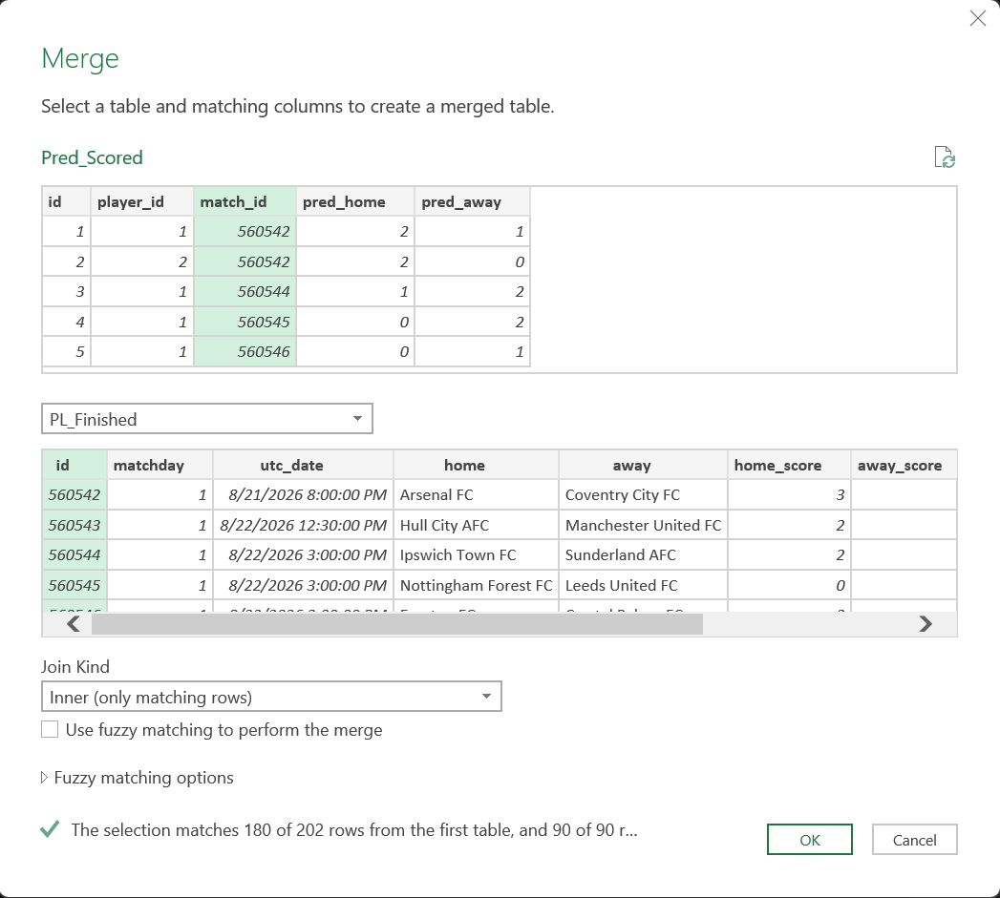
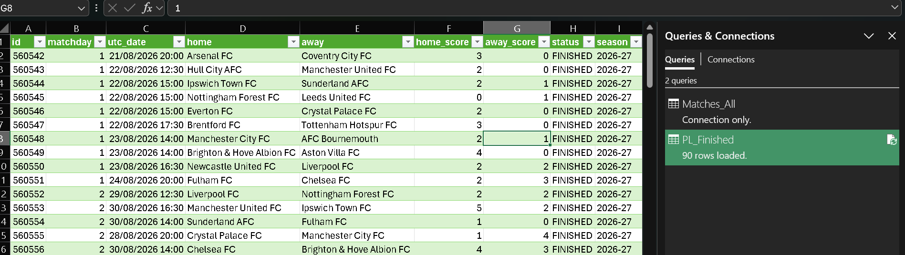
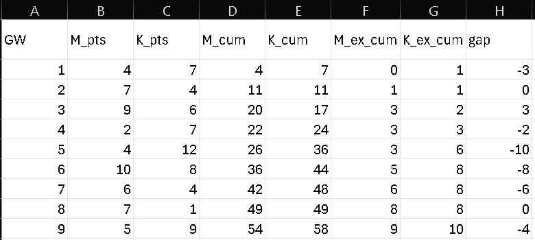
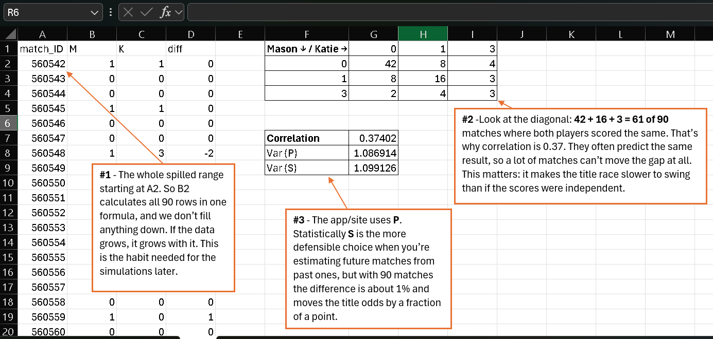
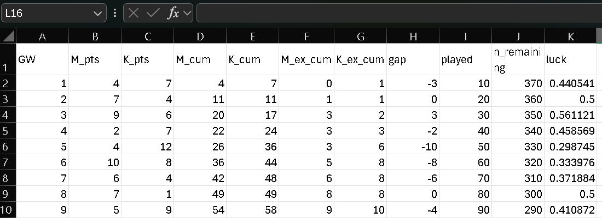
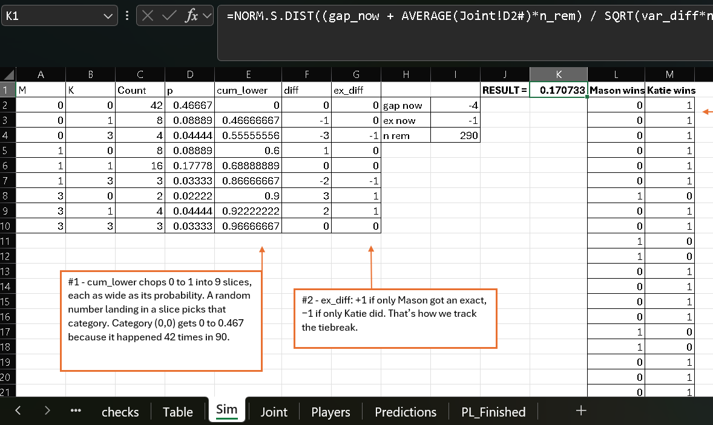
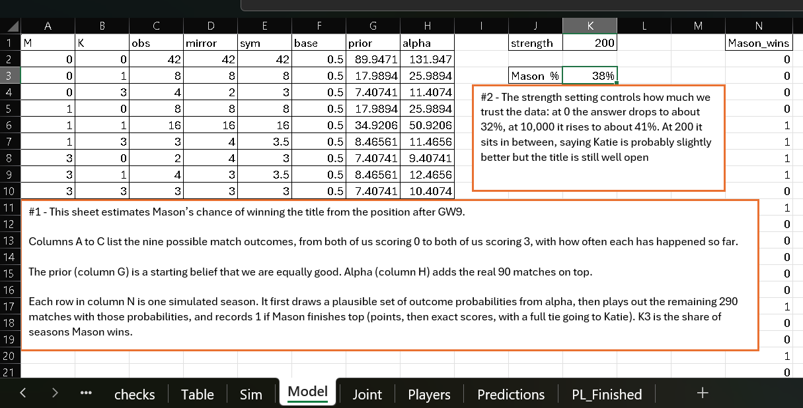
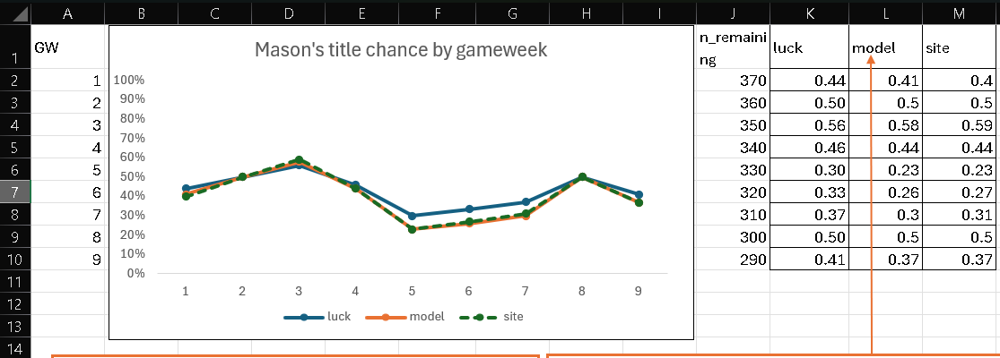
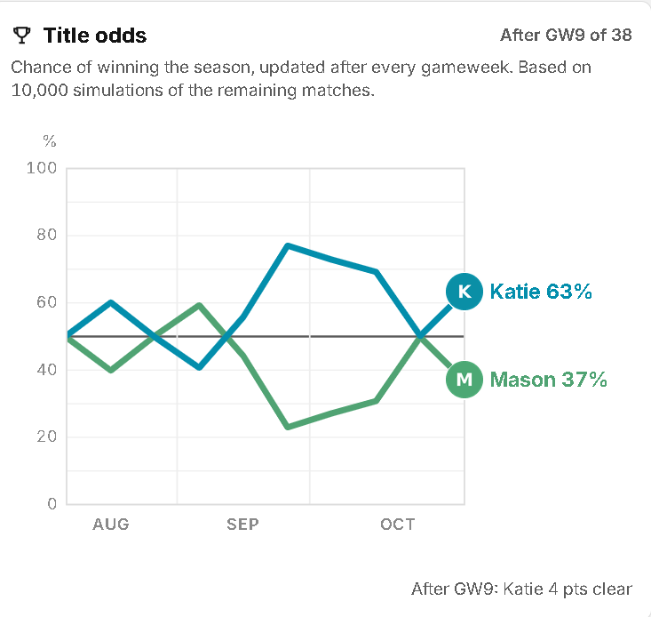
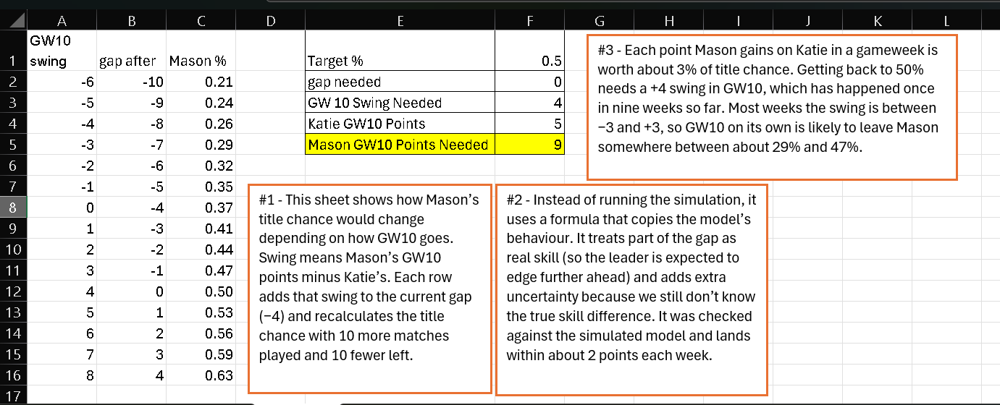

# Method

How I rebuilt the EPL Tally title-odds model in Excel 365, one stage at a time, and how each stage was checked before moving on.

Back to the [README](../README.md).

## Contents

1. [Import and join](#1-import-and-join)
2. [Scoring](#2-scoring)
3. [Running table](#3-running-table)
4. [Joint outcome grid](#4-joint-outcome-grid)
5. [Luck formula](#5-luck-formula)
6. [Simple simulation](#6-simple-simulation)
7. [Dirichlet-multinomial model](#7-dirichlet-multinomial-model)
8. [Gameweek by gameweek](#8-gameweek-by-gameweek)
9. [Scenarios](#9-scenarios)
10. [What I'd change](#10-what-id-change)

The rule throughout: nothing moves to the next stage until it matches a number I already know, from the site or from a hand calculation.

---

## 1. Import and join

I exported three tables from the app's SQLite database as CSV: matches, predictions and players. Power Query loads them as UTF-8 with a UK locale, so dates read as day/month.

- **Matches_All** is connection-only. The app also stores Champions League fixtures and older seasons, so nothing loads from it directly.
- **PL_Finished** filters it to the 2026-27 Premier League season with status FINISHED. That gives 90 rows, which is nine full gameweeks.
- **Pred_Scored** inner joins predictions to PL_Finished on match ID, keeping only the matchday and the two scores from the match side.

The merge dialog reports 180 of 202 predictions matched, and 90 of 90 matches. The 22 unmatched predictions are picks for matches that hadn't been played yet. 90 matches times 2 players is 180, so every finished match has a prediction from both of us.

**Check:** 90 matches, 180 scored predictions, no orphans on the match side.

## 2. Scoring

Scoring uses two helper columns rather than one long formula:

- **Result code:** `SIGN(home - away)` for both the prediction and the actual score. Same sign means the right result.
- **Exact:** `AND(pred_home = home, pred_away = away)`.

Points are then 3 for exact, 1 for the right result, 0 otherwise.

**Check:** Mason 54 points with 9 exact scores, Katie 58 with 10. Both match the site's leaderboard.

## 3. Running table

Points and exact scores per gameweek, then cumulative totals using `SUMIFS` with a `"<="` condition on gameweek. The gap is Mason minus Katie.

| GW | 1 | 2 | 3 | 4 | 5 | 6 | 7 | 8 | 9 |
|---|---|---|---|---|---|---|---|---|---|
| Gap | -3 | 0 | 3 | -2 | -10 | -8 | -6 | 0 | -4 |

This table drives everything after it. Later stages look up a gameweek's gap, exact-score difference and matches remaining from here with `INDEX`.

## 4. Joint outcome grid

Each match gives a pair: Mason's points and Katie's points. With three possible scores each, there are nine combinations. The grid counts how often each one happened.

| Mason ↓ / Katie → | 0 | 1 | 3 |
|---|---|---|---|
| **0** | 42 | 8 | 4 |
| **1** | 8 | 16 | 3 |
| **3** | 2 | 4 | 3 |

It's built with dynamic arrays (`UNIQUE`, `SORT` and spill references), so one formula fills the whole range and it grows with the data.

The diagonal is the important bit. In 42 + 16 + 3 = 61 of the 90 matches, we scored the same. Those matches can't move the gap at all. That's why our scores have a correlation of 0.37, and why treating the two players as independent would make the race look far more volatile than it is.

Two numbers from here feed the later stages:

- **Correlation:** 0.374
- **Variance of the per-match difference** (Mason minus Katie): 1.087 with `VAR.P`, 1.099 with `VAR.S`

The site uses population variance, so I matched it. Sample variance is arguably the better choice, but the difference moves the odds by a fraction of a percentage point.

## 5. Luck formula

The simplest possible answer: assume we're equally good from here on, so every remaining match is pure noise around zero. Over n matches the gap moves by a total with mean 0 and variance $\sigma^2 n$. Mason wins if the final gap is above zero:

$$P(\text{Mason wins}) = \Phi\left(\frac{g}{\sigma\sqrt{n}}\right)$$

where g is the current gap, $\sigma^2$ is the per-match variance (1.087) and n is matches remaining. In Excel that's `NORM.S.DIST(gap / SQRT(var * n_remaining), TRUE)`.

At GW9: g = -4, n = 290, so -4 / √(1.087 × 290) = -0.225, which gives **41.1%**.

**Check:** reproduces the site's luck figure exactly at every gameweek: 44.1, 50.0, 56.1, 45.9, 29.9, 33.4, 37.2, 50.0, 41.1.

This ignores the exact-score tiebreak. With a spread this wide, the chance of finishing exactly level is small enough not to matter here.

## 6. Simple simulation

The obvious next step: simulate the rest of the season using the grid from stage 4 as the probabilities. Each of the nine outcomes gets a probability equal to its share of the 90 matches. A random number picks an outcome for each remaining match (`RANDARRAY` plus `XMATCH` against cumulative probabilities), and the season is scored with the tiebreak.

Over 1,000 simulated seasons, Mason wins about **17%**. The Sim sheet shows both numbers side by side: the closed form below in K1 and the simulated share in K2.

That's a long way from 41%, using the same data, so I worked out why before going further. The grid has Katie 4 points ahead over 90 matches, which is an average of -0.044 per match. The simulation carries that edge into every remaining match. Over 290 matches it adds up to about -12.9 points of drift. Putting that drift into the luck formula:

$$\Phi\left(\frac{g + \bar{d}\,n}{\sigma\sqrt{n}}\right) = \Phi\left(\frac{-4 - 12.9}{17.75}\right) = 17.07\%$$

So the simulation is just the luck formula with Katie's observed edge assumed to be permanent and exact.

Neither answer is right. The luck formula says 90 matches tell us nothing about who's better. The simulation says they tell us everything. Four points over 90 matches is weak evidence, and the gap was +3 the other way at GW3.

## 7. Dirichlet-multinomial model

The fix is to stop treating the nine probabilities as known. Instead, each simulated season draws its own set of probabilities, from a distribution that reflects how sure we are about them.

**The distribution.** A Dirichlet distribution with parameters $\alpha$ gives a random set of nine probabilities that sum to 1. Bigger $\alpha$ values mean less spread. Each simulated season:

1. draws probabilities $p \sim \text{Dirichlet}(\alpha)$
2. plays out the remaining matches using those probabilities
3. applies the tiebreak (points, then exact scores, then Katie on a full tie)
4. records whether Mason won

**The parameters.** $\alpha$ is a prior plus the observed counts:

$$\alpha = \text{prior} + \text{counts}$$

**The prior** says "assume equal skill", built in three steps:

1. Take the observed grid and add a small base to every cell, so no outcome has zero weight.
2. Average each cell with its mirror, so (Mason 3, Katie 0) gets the same weight as (Mason 0, Katie 3). This keeps the shape of the data, like how often both of us score 0, but removes any sign of who is better.
3. Scale it so the cells sum to the prior strength, 200. That makes the prior worth 200 matches of equal-skill evidence.

Columns C to H of the sheet are those steps: observed, mirror, symmetrised, base, prior, alpha.

**Drawing a Dirichlet in Excel.** Excel has no Dirichlet function. The standard trick is to draw nine independent Gamma values, each with shape $\alpha_i$ and scale 1, using `GAMMA.INV(RAND(), alpha, 1)`, and divide each by their total. The result is one Dirichlet draw. `SCAN` turns it into cumulative probabilities for picking outcomes.

At GW9 with strength 200, Mason wins about **37%**. That matches the site.

**Prior strength.** This is the one setting that matters. It controls how quickly the model decides the leader is genuinely better.

| Strength | Mason at GW9 | What it means |
|---|---|---|
| 0 | about 32% | Trust the data, but still allow for uncertainty in it |
| 200 | about 37% | The site's setting |
| 10,000 | about 41% | The prior swamps the data, so it's back to the luck formula |

Strength 0 doesn't fall all the way to 17%. Even with no prior, drawing the probabilities rather than fixing them builds in the uncertainty the simple simulation was missing.

At 200, the prior on its own implies a season-end gap with a standard deviation of about 28 points:

$$380 \times \sqrt{\frac{1.087}{200 + 1}} \approx 27.9$$

**A known difference from the site.** The site's base adds 5 matches' worth of outcomes, weighted by how often each score happens across all predictions. My version adds a flat 0.5 to every cell. At strength 200 this makes almost no difference, and the results below show it.

**Simulation noise.** Each recalculation runs 1,000 seasons (one per row of column N), so a single run moves by about ±1.5 percentage points. For the comparison in stage 8 I recalculated three times at each gameweek and kept the middle result. The site uses 10,000 seasons with a fixed seed per gameweek, so its numbers don't move at all.

## 8. Gameweek by gameweek

One cell, `gw_sel`, controls which point in the season the model looks at. Changing it filters the match data to games up to that week, and pulls that week's gap, exact-score difference and matches remaining from the running table.

**The bug.** The first time I ran this for earlier gameweeks, the numbers drifted away from the site. Setting the strength to a non-default value made it obvious. The prior was supposed to show zero difference between us, and it was showing +6.7.

The mirror column wasn't filtered by gameweek. It was mirroring the full 90-match grid while the observed column only held matches up to `gw_sel`. So the "equal skill" prior wasn't equal. At GW9 the filter includes every match, so the two columns happened to agree, and the bug was invisible. It only showed when I moved off the default.

After the fix, model against site at every gameweek:

| Gameweek | 1 | 2 | 3 | 4 | 5 | 6 | 7 | 8 | 9 |
|---|---|---|---|---|---|---|---|---|---|
| Excel model | 41 | 50 | 58 | 44 | 23 | 26 | 30 | 50 | 37 |
| Live site | 40 | 50 | 59 | 44 | 23 | 27 | 31 | 50 | 37 |
| Luck formula | 44 | 50 | 56 | 46 | 30 | 33 | 37 | 50 | 41 |

Within 1 percentage point every week.

The chart also shows what the model does compared with luck. It moves further from 50% than the luck line, in whichever direction the gap points, because it treats part of the gap as real skill. It sits above luck at GW3, when Mason led, and below it every time Katie led.

The site figures come from the live chart:

The model values were typed in rather than linked, so they stay fixed when `gw_sel` changes. The site values were entered by hand from the site's chart.

## 9. Scenarios

Running the full simulation for every row of a what-if table is slow, so this sheet uses a closed-form approximation of the model instead. With current gap g, p matches played, r remaining, prior strength s and per-match variance v:

$$\text{drift} = \frac{g \cdot r}{s + p}$$

$$\text{variance} = v \cdot r + \frac{v \cdot r^2}{s + p + 1}$$

$$P(\text{Mason wins}) = \Phi\left(\frac{g + \text{drift}}{\sqrt{\text{variance}}}\right)$$

The drift is the model leaning towards the leader. It's the observed gap per match, shrunk by the prior, carried over the rest of the season. The first variance term is match noise, the same as the luck formula. The second is the extra uncertainty from not knowing the true skill difference, and it's the part the simple simulation left out.

At GW9: drift = -4 × 290 / 290 = -4, variance = 315.2 + 314.2 = 629.4, so $\Phi(-8 / 25.1)$ = **37.5%**.

**Check:** within about 2 percentage points of the full simulation at every gameweek.

The scenario table adds each possible GW10 swing (Mason's points minus Katie's) to the current gap, moves 10 matches from remaining to played, and recalculates. The target calculator runs it backwards: pick a target chance, and it works out the gap needed, the swing needed, and Mason's GW10 points given an assumed score for Katie.

What it shows:

- Each point of swing in a single gameweek is worth about 3 percentage points of title chance.
- Getting back to 50% needs a +4 swing in GW10. That's happened once in nine gameweeks.
- Most weeks the swing is between -3 and +3, so GW10 is likely to leave Mason somewhere between about 29% and 47%.

## 10. What I'd change

- **Use sample variance.** `VAR.S` is the better estimate for future matches. I kept `VAR.P` only so the luck formula would match the site exactly.
- **A tighter automated check on the site.** The site's audit script only fails if the model and luck formula differ by more than 15 percentage points. Checking the simulation against the closed form in stage 9 would catch much smaller errors.
- **More than two players.** The outcome grid is 3 to the power of the number of players, so this approach doesn't scale. Three players would mean 27 categories and four would mean 81. A league of more players needs a different model, probably one that rates each player separately.
